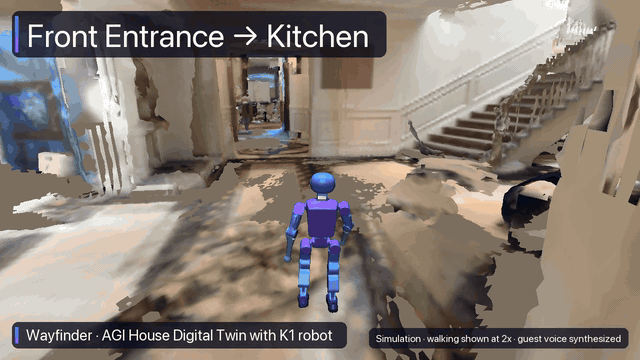
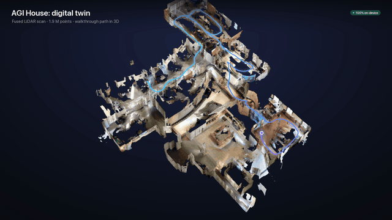
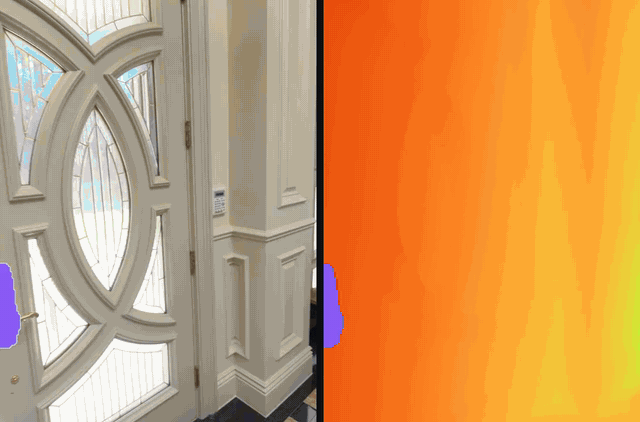
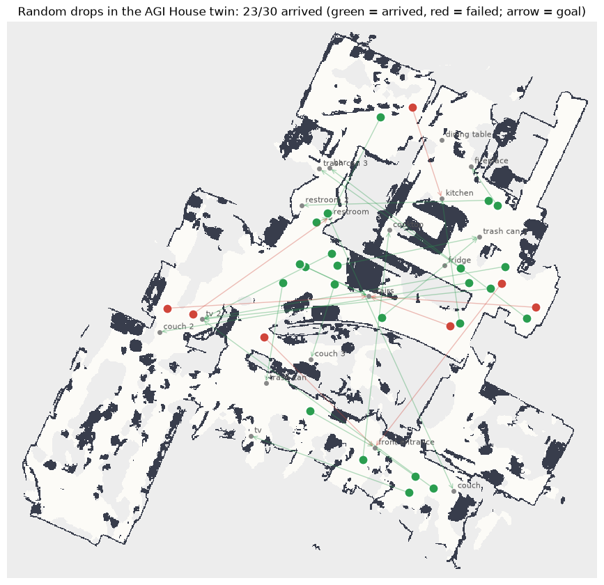

# Wayfinder

**Drop it anywhere in a home. It finds its way, and talks you through it.**
A talking humanoid robot that escorts elderly guests anywhere in the house.



**▶ [Watch the 3-minute demo video](https://github.com/bouncypitch/humanoid-guide-robot/releases/download/v1.0-hackathon/wayfinder_demo_video.mp4)** (simulation in the scanned AGI House twin; voices by ElevenLabs, video only) · **[Project site](https://bouncypitch.github.io/humanoid-guide-robot/)**

| One phone walkthrough becomes a 3D twin | People are masked out of the map | Drop it anywhere: 23/30 arrive |
|---|---|---|
|  |  |  |

**Google Gemma Hardware Hackathon, AGI House, 24 Oct 2026. Physical AI track.**
Everything here was built on the day. Gemma 4 runs on-device and there is no cloud in the runtime loop.

> "Could you take me to the restroom?" "Sure, it's about twenty metres. Shall we go?" "Yes."
> "Walk with me, I'll go slowly… the stairs are on your right… we'll turn left here… here we are."

A Booster K1 humanoid is dropped anywhere in a house it has never walked. It works out where it is
from its own depth camera, without tags or beacons. It talks with the guest, confirms the destination,
and walks them there at a gentle pace, narrating landmarks as it passes them.

## How it works

```
iPhone LiDAR walkthrough ──► TSDF 3D twin ──► cleaned floor plan / cost map ──► MuJoCo K1 twin (rehearsal)
   (ios_app/, android_app/)   (rgbd_ingest.py)   (map_clean.py, scan_map.py)        (k1_sim.py, scan_map.py)
          │
          └─► Gemma 4 finds the house's landmarks (landmarks.py) ─► named destinations + localization cues

Guest's voice + head camera ─► System 2: Gemma 4 E2B (LiteRT-LM, on-device) ─► go_to / where_am_i / wave / stop
                                         (conversation.py, escort.py)
                                              │ confirmed goal
                                              ▼
            System 1: navigator.py: depth scan-matching localization, A* on the cost map,
            drift-corrected path following, Booster's RL walking policy ─► commentary while walking
```

| Stage | What we built | Result |
|---|---|---|
| Capture | **iOS app** (`ios_app/`, SwiftUI + ARKit) records LiDAR depth, confidence, a person mask and the VIO pose per keyframe. **Android app** (`android_app/`, ARCore + LiteRT-LM) uses the same format. | 1,258 RGB-D keyframes, 7 min walk, 287 m |
| Twin | `rgbd_ingest.py` does TSDF fusion with people masked out of depth. `map_clean.py` levels the floor and cleans the map. | 316 m² walkable floor plan at 5 cm |
| Landmarks | `landmarks.py`: Gemma 4 E4B labels 249 frames. Boxes are lifted to 3D with depth + pose, clustered, then **verified by a second Gemma pass on the crops**. | 468 sightings reduced to 18 landmarks (kitchen, restrooms, bar, stairs, fireplace…) |
| Rehearsal | `scan_map.py`: A* on the inflated cost map. The K1 walks the route in MuJoCo with Booster's RL walking policy. | Entrance to restroom 19.7 m and to kitchen 32.9 m: both arrive |
| Localization | `navigator.py`: spin in place, then a **global depth-scan match against the iPhone map**. **Gemma landmark sightings vote** between look-alike rooms; a short probe walk settles remaining ties. Drift is corrected every second, with a final look-around fix on arrival. | Random drop → random destination: **23/30 arrive autonomously, 24/30 when it may ask the guest "which room are we in?"** (median localization error 2 cm; 12/30 at the start of the afternoon). Static localization test: 28/30 within 0.5 m |
| Conversation | `conversation.py` / `escort.py`: Gemma 4 E2B on **LiteRT-LM** hears the audio and sees the head camera. It confirms before walking (enforced in code) and narrates turns and landmarks. | First token ~1 s on a MacBook |
| Real robot | `robot_server.py` (Jetson: `/odom`, `/drive` with a 0.5 s deadman, `/scan` from the head depth camera), `real_robot.py`, `navigator.py --robot real`. See `docs/real_k1_runbook.md`. | Verified end to end against a simulated server (`--dry-run`) |
| Dashboard | `dashboard.py` (Rerun): cost map, plan, belief vs truth, depth scan, localization candidates, Gemma sightings, head camera, events. | `--rerun` / `--rerun-save run.rrd` |

**Safety, independent of the model:**
- Velocity clamps (≤ 0.5 m/s, and 0.3–0.4 m/s while escorting).
- A deadman and a watchdog on the robot server.
- The typed or spoken "stop" bypasses Gemma.
- Gemma's first `go_to` only *proposes* a trip; the guest must agree.
- Goals must be named places from the map.
- Routes are rehearsed in the twin before the real robot moves.

## Try it (Mac, Apple silicon)
```zsh
.venv/bin/python escort.py maps/agihouse --text                       # talk (type) to the K1 in the twin
.venv/bin/python navigator.py maps/agihouse --goal restroom --rerun   # one drop-anywhere trip + live dashboard
.venv/bin/python navigator.py maps/agihouse --goal random --trials 30 # success heatmap
.venv/bin/python navigator.py maps/agihouse --selftest --trials 30    # localization only
.venv/bin/python scan_map.py rehearse maps/agihouse kitchen --gif     # fixed-start rehearsal
```
Rebuild from your own walkthrough:
```zsh
.venv/bin/python rgbd_ingest.py captures/session_X.zip scans/house       # TSDF fusion, people masked
.venv/bin/python map_clean.py scans/house maps/house                     # level, clean, floor plan
.venv/bin/python scan_map.py place maps/house start X Y --yaw DEG        # where the robot starts (front door)
.venv/bin/python landmarks.py captures/session_X maps/house --every 5    # Gemma landmarks -> places.json
```
On the real K1, follow `docs/real_k1_runbook.md`. Environment setup, models and the original single-step
brain are described in `docs/SETUP.md`.

## Honest notes
- The success rates above come from the **MuJoCo twin**. The twin's depth slice is raycast against
  the scanned map, with deliberate corruption: 15% of beams drop out and 10% hit clutter. Real stereo depth
  will be worse, so treat these numbers as an upper bound.
- In the sim, landmark sightings are simulated from what is visible, with a 70% hit rate and 5% false labels.
  On the robot they come from Gemma looking at the head camera.
- Gemma runs on the laptop next to the robot (LiteRT-LM / Ollama, no cloud). Running it on the K1's
  Jetson is described in the runbook but was not verified on the day.
- The Android app builds and passes its unit tests, but was not run on a phone on the day; the capture used
  for the demo came from the iOS app.
- The walk GIF and demo films are renders of the simulated K1 (MuJoCo, Booster's walking policy)
  composited into the scanned house. Voices in the demo video were re-recorded with ElevenLabs (cloud TTS, used for the video only); the guest is not a real person.
  The live robot speaks with on-device text-to-speech.
- Raw captures, videos and landmark crops contain people and are not in this repository (see `.gitignore`).
  Images sent to World Labs for the photoreal twin were face-blurred on-device first (`tools/blur_faces.py`).
