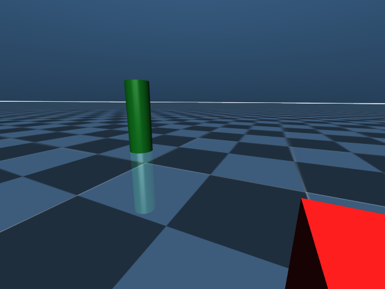
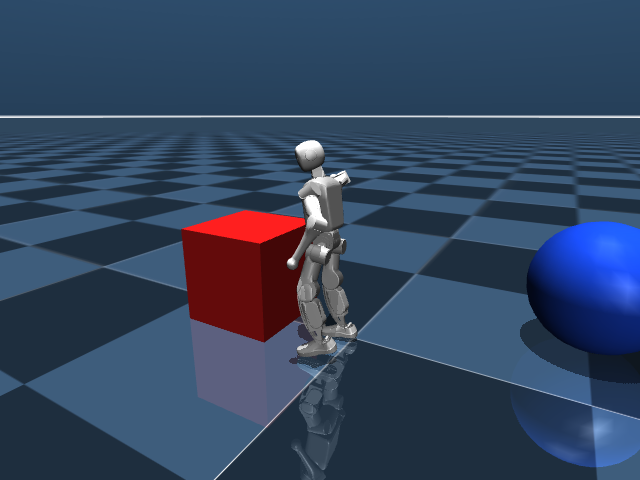

# 03. The K1 walks in its MuJoCo twin

_2026-10-23T23:00_

Booster's own RL walking policy drives a simulated K1 in MuJoCo, using the same velocity commands as the real robot. A head camera lets Gemma see what the robot sees.

| Metric | Value |
|---|---|
| walk | 2 m @ 0.5 m/s |
| turn accuracy | 87° of 90° |
| falls | 0 |

**Say on stage:** We build in simulation first, with the exact walking policy the real robot uses.

