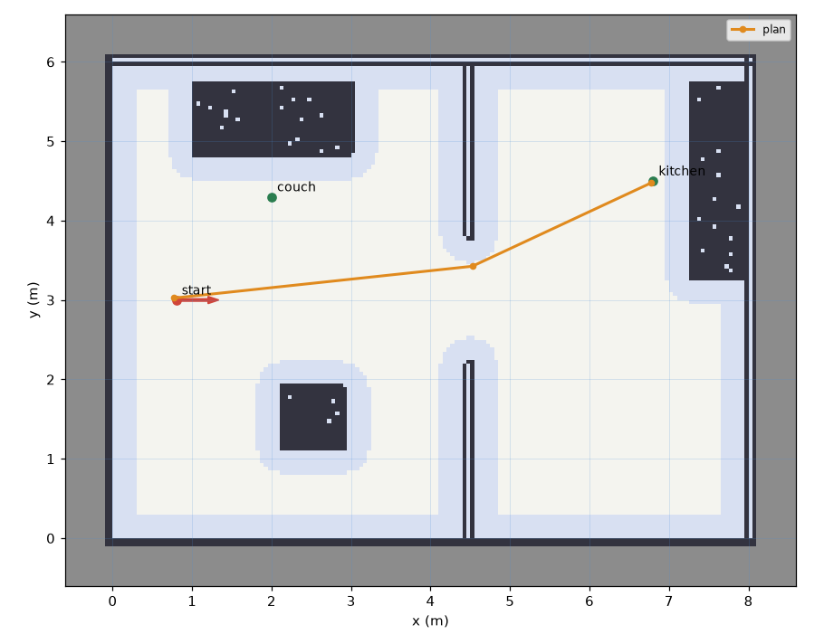
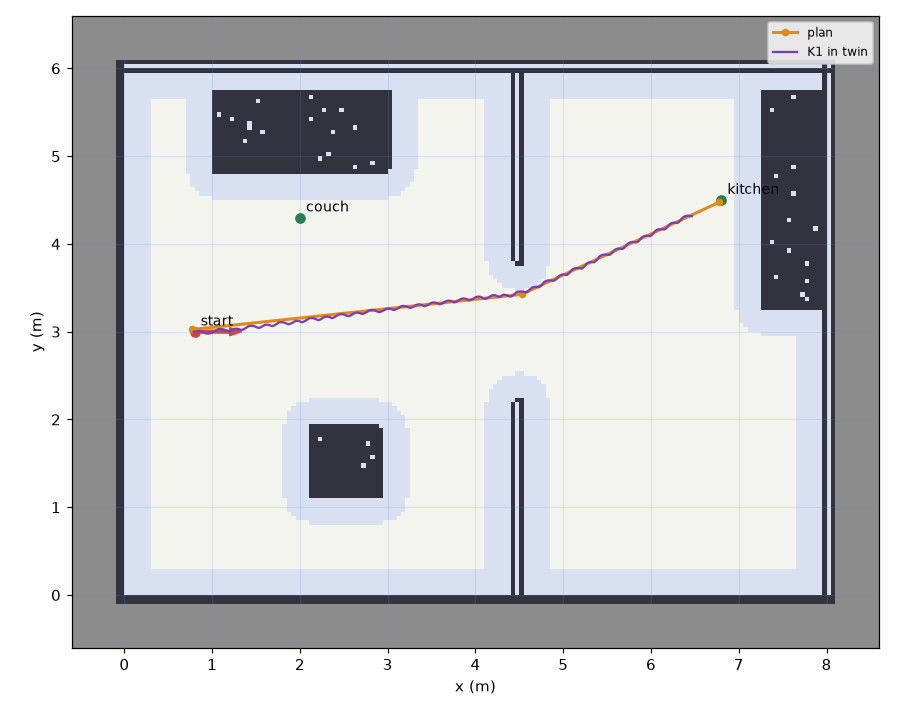

# 04. Scan to floor plan to rehearsal in the twin

_2026-10-24T10:50_

A 3D scan becomes a floor plan with a safety margin for the robot's body. A* plans a route, and the simulated K1 rehearses it before the real robot moves. Tested on a synthetic hallway, living room and kitchen.

| Metric | Value |
|---|---|
| route | 6.3 m, 2 legs |
| rehearsal | arrived |
| sim time | 19.4 s |
| compute time | ~5 s |

**Say on stage:** Every route is rehearsed in a digital twin before the real robot takes a step.

