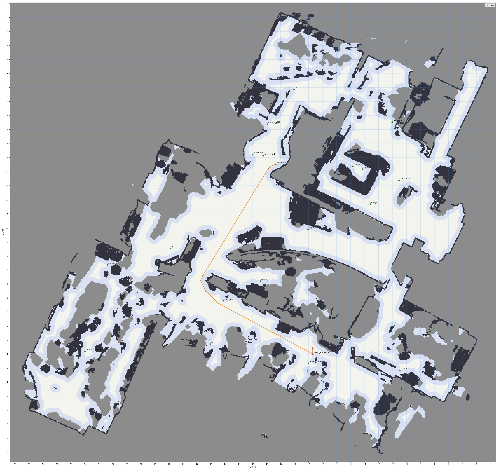
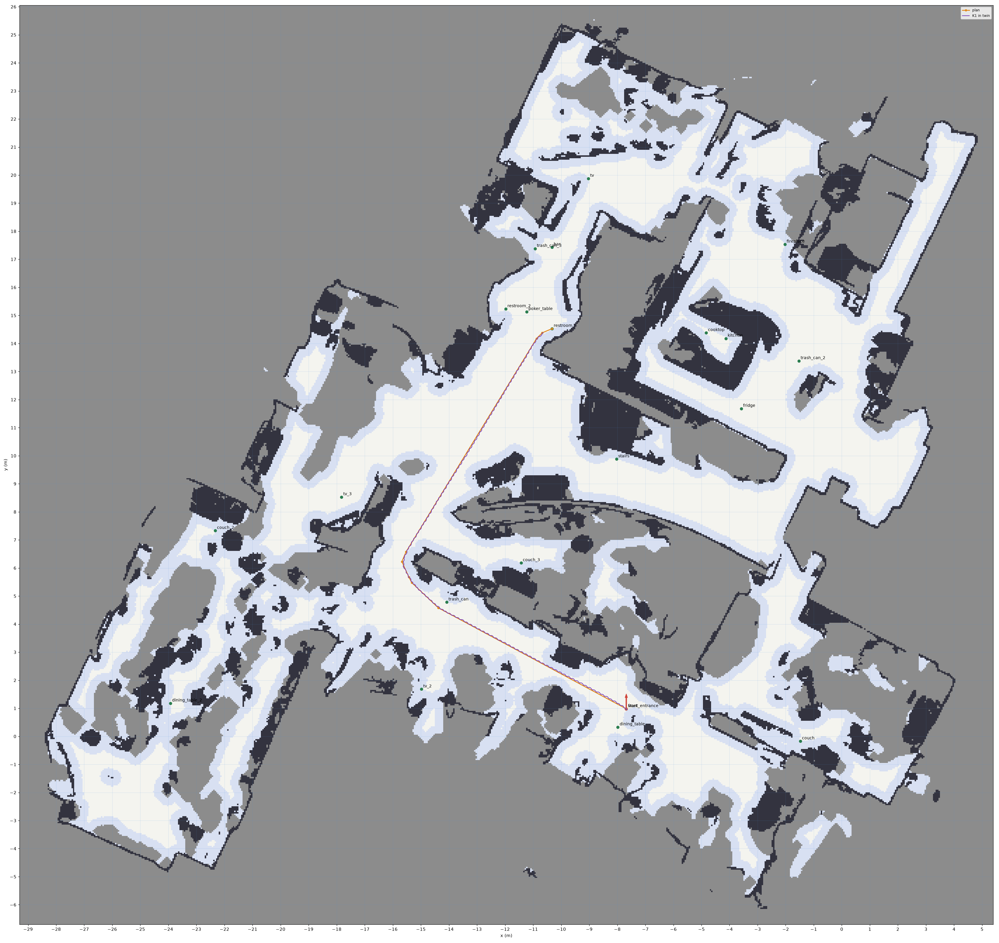
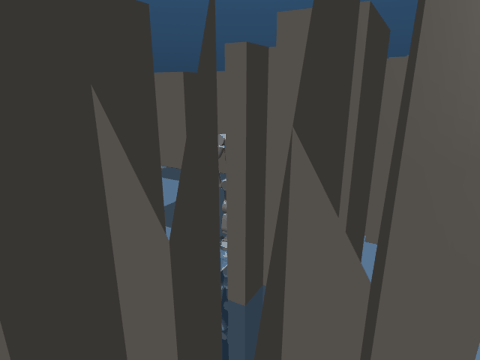

# 05. K1 walks entrance to restroom in the AGI House twin

_2026-10-24T15:06_

First rehearsal on the real scanned map: A* on the cleaned LiDAR occupancy grid, Booster's RL walking policy in MuJoCo follows 8 legs and arrives without touching a wall.

| Metric | Value |
|---|---|
| path_m | 19.7 |
| sim_time_s | 65.6 |
| result | arrived |

**Say on stage:** From the front door to the restroom, 20 metres, rehearsed in the twin before the real robot takes a step.

