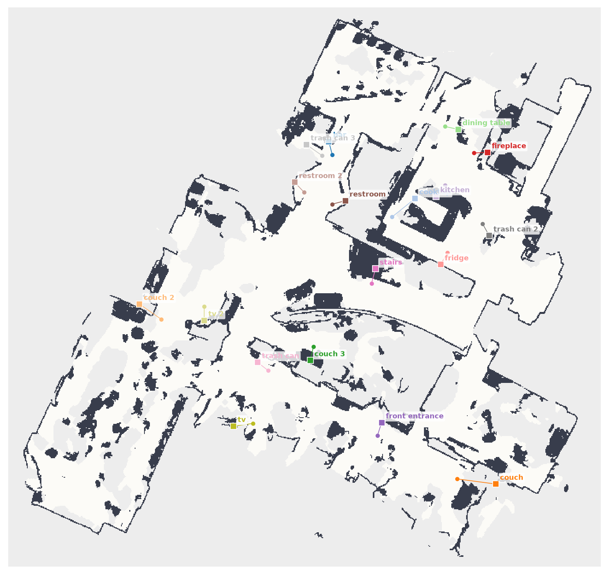
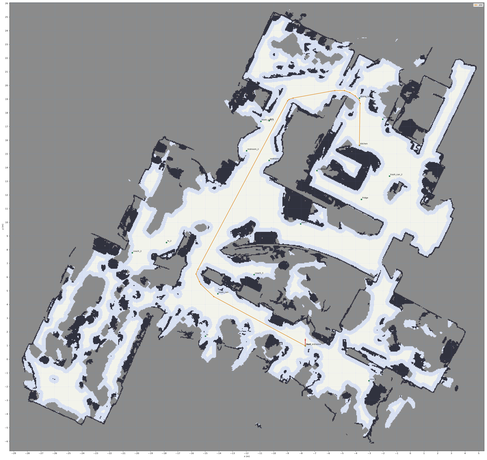
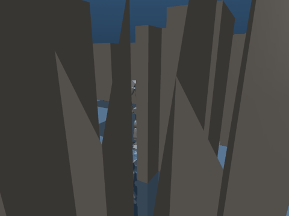

# 06. Gemma landmarks, verified, and routes to kitchen and restroom

_2026-10-24T15:13_

Gemma 4 E4B labelled 249 walkthrough frames (468 sightings). Strict clustering plus a second Gemma pass that checks each crop cut the noise to 18 landmarks; approach points are restricted to floor reachable from the entrance. The K1 then walks to both demo destinations in the twin.

| Metric | Value |
|---|---|
| landmarks | 18 |
| raw_sightings | 468 |
| kitchen_m | 32.9 |
| restroom_m | 19.7 |

**Say on stage:** Gemma found the kitchen, the restrooms, the bar and 15 other landmarks by itself, and double-checked its own work.

