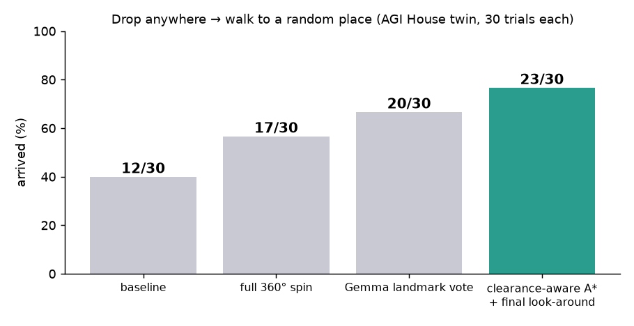
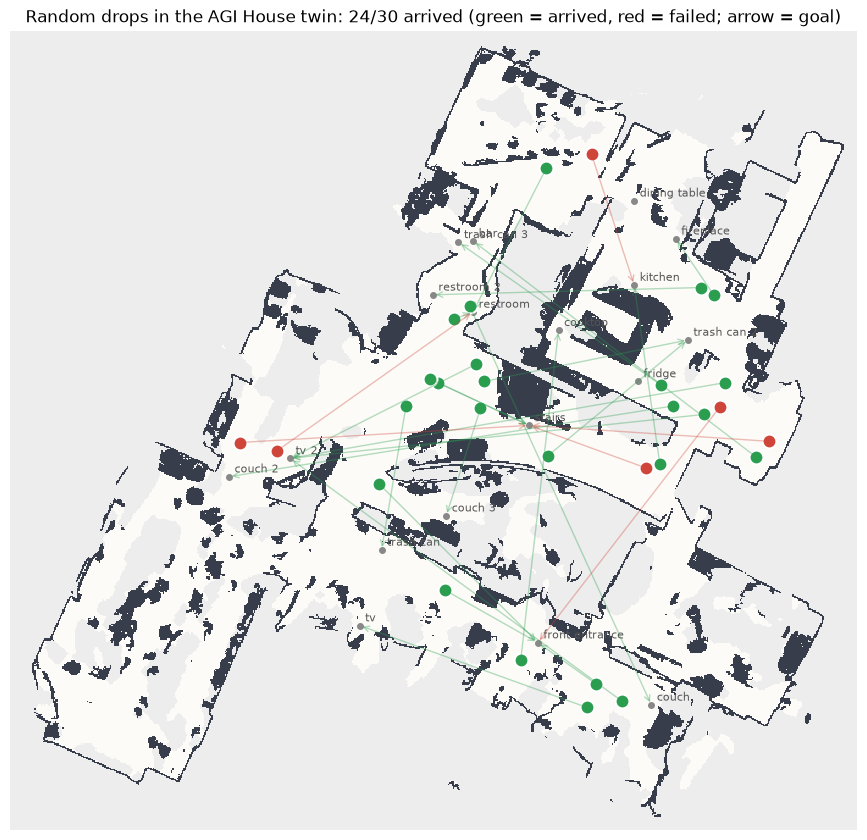

# 07. Drop it anywhere: localization without tags

_2026-10-24T16:46_

The K1 is dropped at a random spot facing a random way. It spins once, matches its depth slice against the iPhone floor plan, lets Gemma's landmark sightings break ties between look-alike rooms, then walks to a random destination with drift correction every second. Depth is deliberately degraded (15% dropouts, 10% clutter hits). When unsure it asks the guest which room they're in.

| Metric | Value |
|---|---|
| autonomous | 23/30 |
| with_one_question | 24/30 |
| median_loc_error_m | 0.02 |
| static_selftest | 28/30 |

**Say on stage:** Drop it anywhere. It looks around, works out where it is from the map we scanned, and if it isn't sure, it simply asks you.

