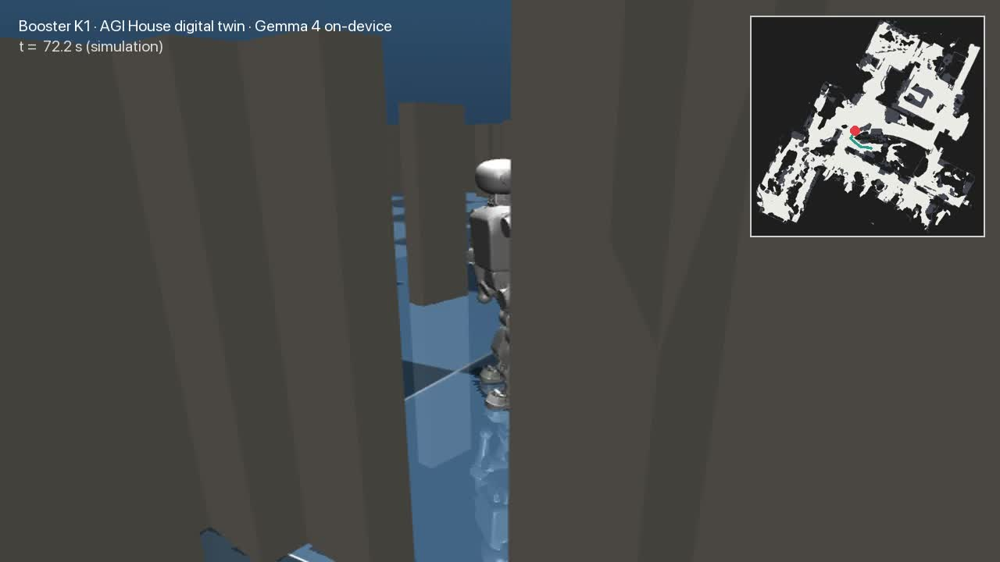

# 08. Talk to it: the full escort

_2026-10-24T16:50_

One process: Gemma 4 E2B (LiteRT-LM, on-device) talks with the guest and sees the head camera. If localization is unsure the robot asks which room it is in. Walking needs the guest's yes (enforced in code). The navigator walks the route while the robot narrates turns and landmarks, then waves on arrival.

| Metric | Value |
|---|---|
| gemma_first_token_s | 0.7 |
| reply_s | 4.5 |
| trip | arrived |

**Say on stage:** Could you take me to the restroom? Shall we go? Yes. Walk with me, I'll go slowly. The couch is on your left. Here we are.

