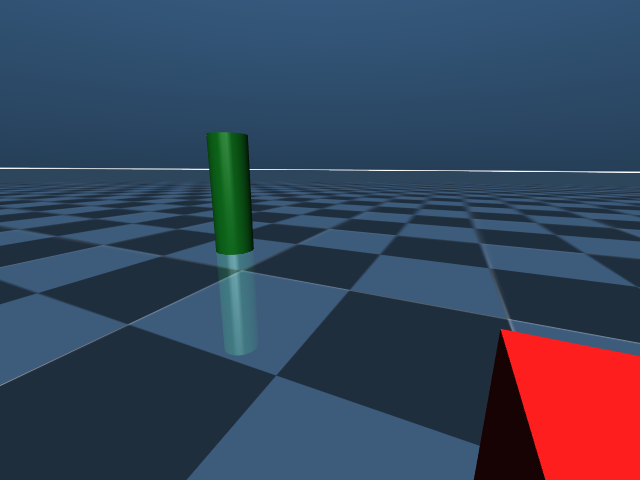
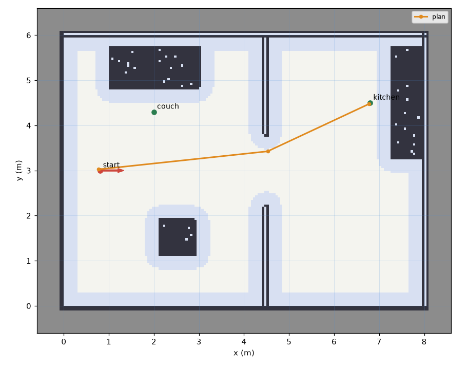
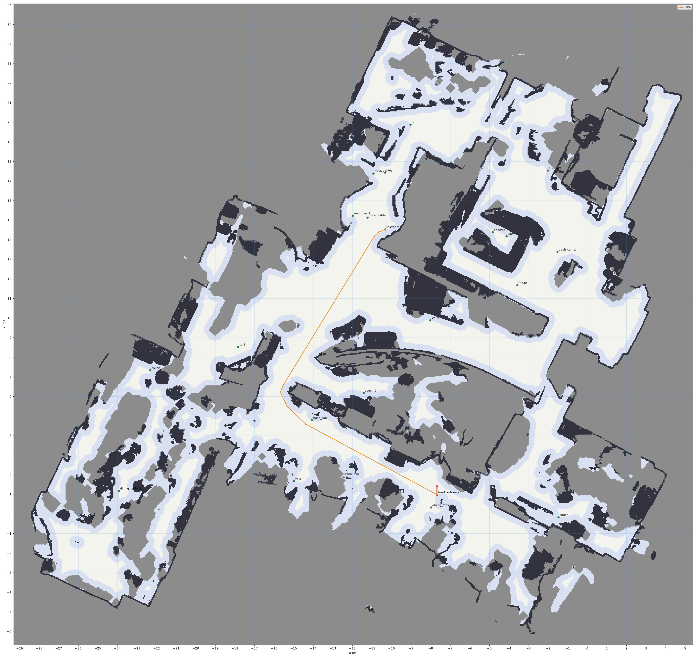
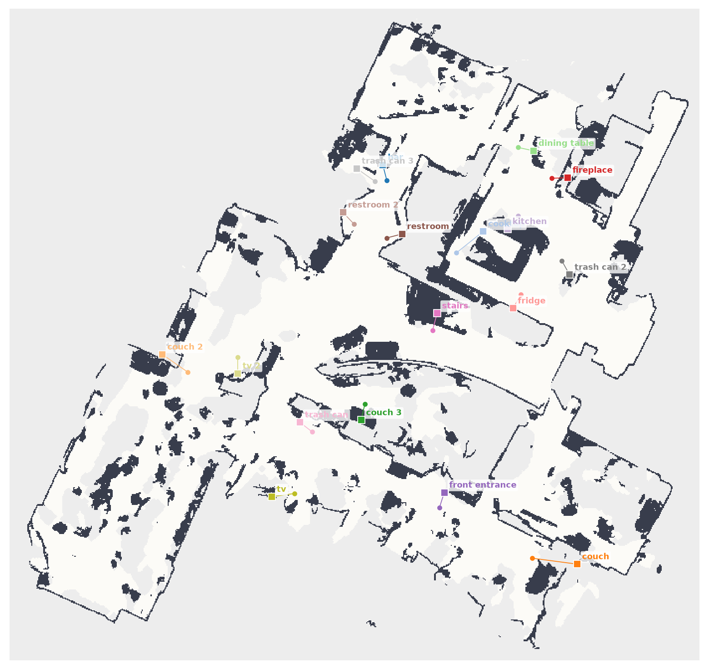
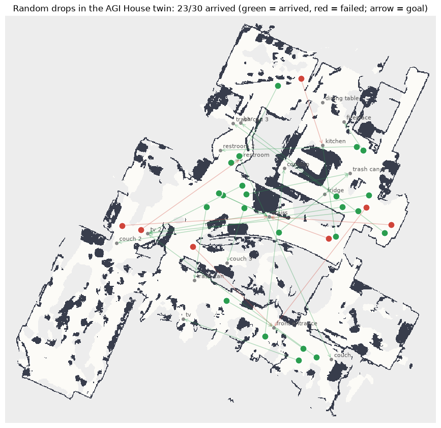
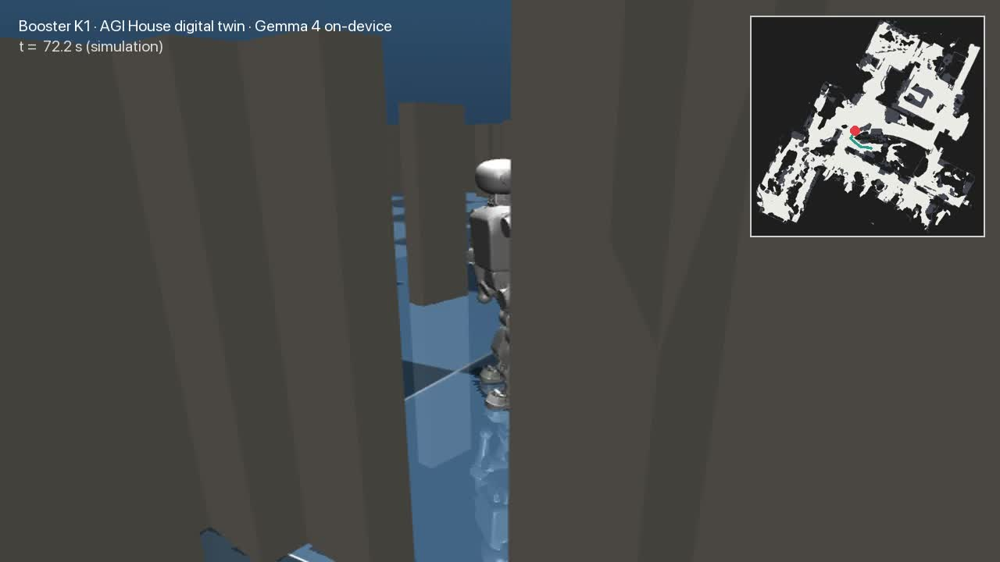

# Wayfinder: build story

Drop it anywhere in a home. It finds its way, and talks you through it.

## 01. [Research: what wins, what's overdone](01-research-what-wins-what-s-overdone/README.md)

_2026-10-23T21:00_ | research agents: 6, hackathons surveyed: 13

Four research agents mapped the Gemma on-device stack, robot SDKs, physical prompt-injection prior art, and recent hackathon winners. Winners: one clear task for a named person, done live on real hardware. Overdone: blind narrators, chatbots, benchmark-only projects.

## 02. [Gemma 4 runs locally with tool calls](02-gemma-4-runs-locally-with-tool-calls/README.md)

_2026-10-23T22:30_ | E2B decision: 1.05 s, E2B decode: 79 tok/s, LiteRT E2B first token: 0.42 s, well-formed tool calls: 11/11

Gemma 4 E2B and E4B on the Mac via Ollama and Google's LiteRT-LM. Given a camera image and six robot tools, every call returned a well-formed tool call. LiteRT-LM also took a spoken command directly as audio: 'turn left' became turn(90).

## 03. [The K1 walks in its MuJoCo twin](03-the-k1-walks-in-its-mujoco-twin/README.md)

_2026-10-23T23:00_ | walk: 2 m @ 0.5 m/s, turn accuracy: 87° of 90°, falls: 0

Booster's own RL walking policy drives a simulated K1 in MuJoCo, using the same velocity commands as the real robot. A head camera lets Gemma see what the robot sees.

## 04. [Scan to floor plan to rehearsal in the twin](04-scan-to-floor-plan-to-rehearsal-in-the-t/README.md)

_2026-10-24T10:50_ | route: 6.3 m, 2 legs, rehearsal: arrived, sim time: 19.4 s, compute time: ~5 s

A 3D scan becomes a floor plan with a safety margin for the robot's body. A* plans a route, and the simulated K1 rehearses it before the real robot moves. Tested on a synthetic hallway, living room and kitchen.

## 05. [K1 walks entrance to restroom in the AGI House twin](05-k1-walks-entrance-to-restroom-in-the-agi/README.md)

_2026-10-24T15:06_ | path_m: 19.7, sim_time_s: 65.6, result: arrived

First rehearsal on the real scanned map: A* on the cleaned LiDAR occupancy grid, Booster's RL walking policy in MuJoCo follows 8 legs and arrives without touching a wall.

## 06. [Gemma landmarks, verified, and routes to kitchen and restroom](06-gemma-landmarks-verified-and-routes-to-k/README.md)

_2026-10-24T15:13_ | landmarks: 18, raw_sightings: 468, kitchen_m: 32.9, restroom_m: 19.7

Gemma 4 E4B labelled 249 walkthrough frames (468 sightings). Strict clustering plus a second Gemma pass that checks each crop cut the noise to 18 landmarks; approach points are restricted to floor reachable from the entrance. The K1 then walks to both demo destinations in the twin.

## 07. [Drop it anywhere: localization without tags](07-drop-it-anywhere-localization-without-ta/README.md)

_2026-10-24T16:46_ | autonomous: 23/30, with_one_question: 24/30, median_loc_error_m: 0.02, static_selftest: 28/30

The K1 is dropped at a random spot facing a random way. It spins once, matches its depth slice against the iPhone floor plan, lets Gemma's landmark sightings break ties between look-alike rooms, then walks to a random destination with drift correction every second. Depth is deliberately degraded (15% dropouts, 10% clutter hits). When unsure it asks the guest which room they're in.

## 08. [Talk to it: the full escort](08-talk-to-it-the-full-escort/README.md)

_2026-10-24T16:50_ | gemma_first_token_s: 0.7, reply_s: 4.5, trip: arrived

One process: Gemma 4 E2B (LiteRT-LM, on-device) talks with the guest and sees the head camera. If localization is unsure the robot asks which room it is in. Walking needs the guest's yes (enforced in code). The navigator walks the route while the robot narrates turns and landmarks, then waves on arrival.

